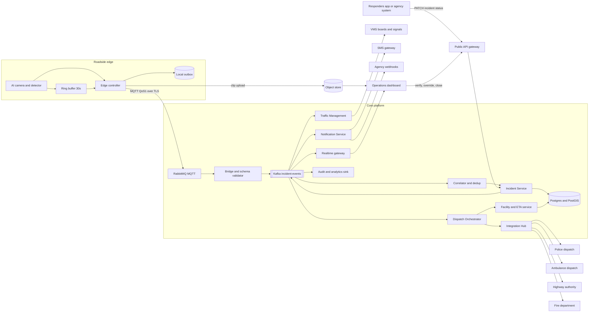
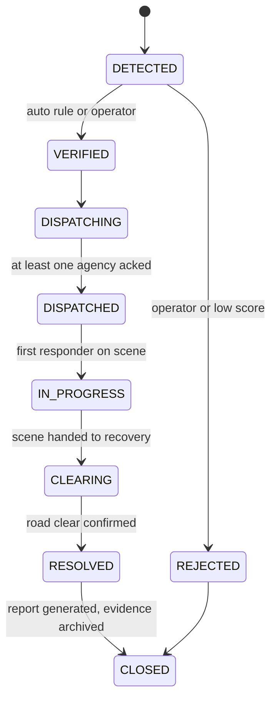
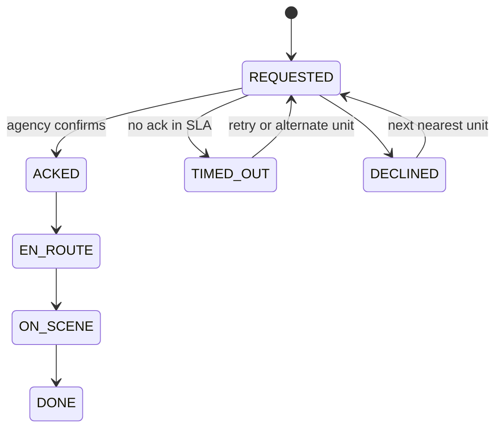
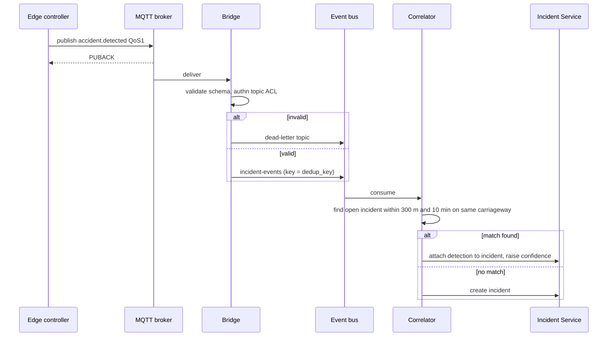
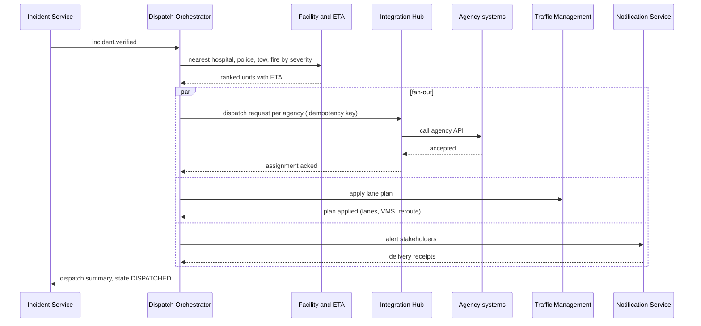
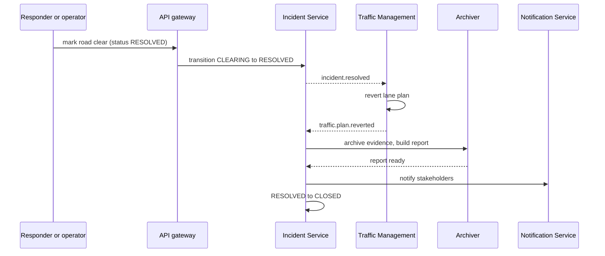

# ATMS Architecture and End-to-End Flows

Status: contracts, edge and agency simulators, Hugging Face detector and the core services are built and tested. See section 10 for what is real and what is still a stand-in.

Scope: accident detection to emergency response to road reopening, for one highway corridor (example: NH48, Pune, camera GNT001). The same design extends to more event types (breakdown, wrong-way vehicle, congestion) by adding event schemas.

## 1. Design principles

1. The edge never blocks on the cloud. Every detection is written to a local outbox first and published after.
2. Every event carries a stable `event_id` and a `dedup_key`. Every consumer is idempotent.
3. One writer for incident state. Only the Incident Service changes an incident. Everything else asks it through events or its API.
4. Dispatch is a saga. Each side effect (notify, close lanes, call an agency) is tracked, acknowledged, retried and escalated.
5. A human can always take over. Verification, dispatch and closure all have an operator override from the dashboard.
6. Video is evidence. It is stored once, immutably, and referenced by key. It never travels through the broker.

## 2. Logical architecture

Components and ownership

| Component | Owns | Notes |
|---|---|---|
| Edge controller | Detection intake, outbox, clip upload | Survives network loss, publishes with retry |
| MQTT broker (RabbitMQ) | Device connectivity only | Topic permissions per device, no business logic |
| Bridge | RabbitMQ queue to Kafka, schema validation | Rejects malformed events to a dead-letter topic |
| Correlator | Merging reports of the same crash | Spatial and time window match |
| Incident Service | Incident record and state machine | Single writer, emits every state change |
| Dispatch Orchestrator | The dispatch saga | Tracks each agency assignment to a final state |
| Facility and ETA service | Nearest facilities, ETA | PostGIS plus a routing engine |
| Notification Service | SMS, webhooks, push | Delivery receipts feed back as events |
| Traffic Management | Lane closure plan, VMS, reroute, reopen | Reverts its own plan on resolve |
| Realtime gateway | WebSocket fan-out to dashboards | Reads the bus, holds no state of its own |
| Integration Hub | Adapters to each agency | One adapter per agency, own retry and circuit breaker |

## 3. State machines

Incident state, owned by the Incident Service

Assignment state, one per agency per incident, owned by the Dispatch Orchestrator

The original diagram had a single `in_progress` status. Splitting incident state from assignment state fixes the ambiguity between "unit dispatched" and "incident being handled".

## 4. End-to-end flows

### F1. Detection to publish (edge)

1. The detector scores a frame sequence. Above the publish threshold it emits a detection with type, confidence, severity, vehicle count and bounding boxes.
2. The edge controller freezes the ring buffer (30 s before) and keeps recording 30 s after. It cuts one clip.
3. It writes the event to the local outbox with a new `event_id` and a `dedup_key = camera_id + 10 s time bucket + type`.
4. A publisher drains the outbox to MQTT at QoS 1 on `atms/{state}/{city}/{road}/{camera}/event/accident`. The outbox row is deleted only after the broker acks.
5. In parallel an uploader sends the clip to the object store using a resumable upload and a pre-signed URL. The event carries `video_ref` (object key) and `video_status = uploading`. When the upload completes it publishes a small `video.ready` event.
6. The event includes GPS, camera heading, lane map and the detector model version.

Why this matters: a dead uplink delays the event but never loses it, and a slow video upload never delays the alert.

### F2. Ingest, validation, correlation

Rules

- Duplicate `event_id` is dropped. Same `dedup_key` from the same camera is merged.
- Two cameras reporting within the spatial and time window become one incident with two evidence clips.
- Bus partitioning key is the road segment, so correlation for one stretch is ordered.

### F3. Incident creation and verification

1. The Incident Service creates the record in `DETECTED` with location, severity, confidence, evidence refs and the originating events.
2. A policy decides the verification path.
   - Confidence at or above 0.90 and severity Major or Critical: auto-verify and go straight to dispatch. The dashboard still shows it so an operator can reject within a grace window.
   - Confidence between 0.60 and 0.90: dashboard alert asks an operator to verify against the live clip. Traffic Management may apply a precautionary advisory only.
   - Below 0.60: logged for model tuning, no incident.
3. Verification emits `incident.verified` or `incident.rejected`. Thresholds are configuration, not code.

### F4. Dispatch saga

Rules

- Severity drives which agencies are called. Example: Major means police, ambulance and tow. Critical or fire flag adds fire. Minor means police and tow only.
- Every agency request has a timeout (for example 60 s for ambulance). On timeout the orchestrator retries the same agency, then picks the next nearest unit, then alerts the operator to call manually.
- A failed lane plan or a failed notification never blocks agency dispatch. Only agency assignments gate `DISPATCHED`.
- All requests use an idempotency key `incident_id + agency + attempt group`, so a retry never sends a second ambulance.

### F5. Responder status updates

1. The responder app or agency system calls `PATCH /v1/incidents/{id}/assignments/{assignment_id}` with the new status and ETA.
2. The API gateway authenticates (OAuth client credentials per agency, short-lived tokens) and checks the agency owns that assignment.
3. The Incident Service validates the transition against the assignment state machine, applies it with optimistic locking, and emits `responder.status.changed`.
4. The first `ON_SCENE` moves the incident to `IN_PROGRESS`. All assignments `DONE` moves it towards `CLEARING`.
5. Status that arrives out of order is rejected with 409 and the current state returned.

Fixes the diagram: the responder is not talking to the dashboard. The dashboard is a read model fed by the bus.

### F6. Operations dashboard

1. On load, the dashboard fetches the snapshot over REST (open incidents, units, active lane plans).
2. It then opens one WebSocket and receives deltas from the Realtime gateway, which subscribes to the bus with a per-user filter (region, road).
3. Each delta carries an incident version number. If the client sees a gap it refetches the snapshot.
4. Operator actions (verify, reject, reassign unit, add note, close) go through the same API as everything else and appear for all operators as events. Every action is audited with user id and time.
5. Live video and clips are served through short-lived signed URLs.

### F7. Traffic management (close and reopen)

1. On `incident.verified` Traffic Management reads the lane map and affected lanes, builds a plan, and applies it. The plan has speed limits upstream, lane closure signs, VMS text, and an advisory feed for alternative routes.
2. Each device command is tracked. A VMS board that does not confirm raises an operator task.
3. The plan is stored as an object tied to the incident so it can be reverted exactly.
4. On `incident.resolved` Traffic Management reverts the plan in reverse order (reopen lanes, remove closure, restore speed, clear VMS) and emits `traffic.plan.reverted`.
5. Closure and reopen are both visible in the incident timeline.

### F8. Resolution and closeout

Rules

- Resolution needs a responder or operator action. It is not inferred from traffic data in the first version. A later version can cross-check against camera flow before accepting it.
- CLOSED is reached only when the lane plan is reverted and the report exists.
- Evidence moves to long-term storage with a legal-hold flag, and the incident becomes read only.

### F9. Failure and degraded modes

| Failure | Behaviour |
|---|---|
| Edge loses uplink | Outbox buffers, retries with backoff, on-site VMS fallback rule can still run locally for severity Critical |
| Broker down | Edge keeps outbox, broker is run as a cluster, edge reconnects automatically |
| Bridge or bus lag | Bus consumers are idempotent, alerts show queue age so operators see staleness |
| Poison message | Goes to the dead-letter topic with the reason and raises a ticket |
| Incident Service down | Events wait on the bus, API returns 503 with retry-after, dashboard shows banner |
| Agency API down | Circuit breaker opens, orchestrator moves to the next unit or alerts an operator to phone it in |
| Notification gateway down | Retry, then fall back to a second SMS provider, failure is visible on the incident |
| VMS board unreachable | Operator task created, plan still counted applied for the other devices |
| Duplicate detections | Merged by the correlator |
| False positive | Operator reject within grace window, plan and dispatch are cancelled and compensated |
| Operator cancels after dispatch | Orchestrator sends cancel to each agency and reverts the lane plan |

Cancel and reject are first-class paths because every dispatch step has a compensating action.

## 5. Contracts

Event catalogue (all share `event_id`, `incident_id` where known, `occurred_at`, `producer`, `schema_version`)

| Event | Producer | Main consumers |
|---|---|---|
| accident.detected | Edge controller | Bridge, correlator |
| video.ready | Edge controller | Incident Service, dashboard |
| incident.created | Incident Service | Dashboard, audit |
| incident.updated | Incident Service | Dashboard, audit |
| incident.verified | Incident Service | Dispatch Orchestrator, Traffic Management |
| incident.rejected | Incident Service | Orchestrator (compensate), Traffic Management |
| assignment.requested | Orchestrator | Integration Hub |
| assignment.acked, declined, timed_out, cancelled | Orchestrator | Incident Service |
| responder.status.changed | Incident Service | Dashboard, Traffic Management, Notification |
| traffic.plan.applied or reverted | Traffic Management | Incident Service, dashboard |
| incident.resolved | Incident Service | Traffic Management, Archiver, Notification |
| incident.closed | Incident Service | Audit, analytics |

Public API (versioned, all idempotent where unsafe)

| Method and path | Caller | Purpose |
|---|---|---|
| GET /v1/incidents | Dashboard | List and snapshot |
| GET /v1/incidents/{id} | Dashboard, agencies | Detail with timeline |
| POST /v1/incidents/{id}/verify, /reject, /close | Operator | Manual decisions |
| POST /v1/incidents/{id}/resolve | Operator or assigned agency | Road clear |
| PATCH /v1/incidents/{id}/assignments/{aid} | Responder | Status and ETA |
| POST /v1/incidents/{id}/notes | Operator, responder | Notes |
| GET /v1/incidents/{id}/evidence | Dashboard | Signed URLs |
| WS /v1/stream | Dashboard | Deltas |

Core data model

| Table | Key columns |
|---|---|
| incident | id, state, severity, confidence, location (geography), road_segment, version, opened_at, resolved_at |
| detection | event_id, incident_id, camera_id, model_version, confidence, occurred_at, dedup_key |
| evidence | id, incident_id, object_key, kind, sha256, retention_class |
| assignment | id, incident_id, agency, unit_ref, state, eta, requested_at, acked_at |
| traffic_plan | id, incident_id, lanes, vms_messages, applied_at, reverted_at |
| facility | id, kind, name, location (geography), capabilities |
| notification | id, incident_id, channel, recipient, status, receipt |
| audit_log | id, actor, action, incident_id, at, before, after |

## 6. Non-functional design

Latency budget from detection to dispatch acknowledgement requested

| Hop | Target |
|---|---|
| Detector to edge publish | 1 s |
| Broker to bus to correlator | 1 s |
| Incident create and verify policy | 0.5 s |
| Facility lookup and ETA | 1 s |
| Agency request sent | 1 s |
| Total to requests out | about 5 s |

Agency acknowledgement time is outside our control and is measured separately.

Security

- Devices authenticate with per-device X.509 certificates, topic ACLs allow publish on their own subtree only.
- Agencies and the dashboard use OIDC. Operators get roles (viewer, operator, supervisor). Agencies get scoped client credentials.
- Webhooks to agencies are signed with HMAC and carry a timestamp to stop replay.
- Video and evidence are encrypted at rest and reachable only through short-lived signed URLs.
- Faces and plates in stored clips follow a retention and access policy set with the road authority.

Observability

- One trace id from `event_id` through every service. Dashboard shows detection to dispatch time per incident.
- Metrics: end-to-end latency per hop, outbox depth at each edge, bus lag, ack rate per agency, false-positive rate, dead-letter count.
- Alerts: edge silent for more than N minutes, outbox growing, agency ack rate falling, any event in dead-letter.

Deployment

- Edge: container on the roadside controller, local queue and clock sync (NTP or GPS time).
- Core: stateless services on Kubernetes, broker and bus as managed or clustered, Postgres with a replica and PostGIS.
- Environments: dev with a camera simulator, staging with replayed real clips, production per region.

## 7. Corrections to the original diagram

1. Resolution comes from the responder or operator through the Incident Service, not from Traffic Management.
2. The dashboard is fed by the event bus through the Realtime gateway, with a snapshot API for loading.
3. Responders talk to the API only. The dashboard to responders arrow is removed.
4. Incident status and assignment status are separate, so "in progress" is no longer overloaded.
5. Ambulance ETA is one value, owned by the assignment record and shown everywhere from there.
6. Broker routing is explicit: MQTT for devices, a bridge into one event bus for services.
7. Added verification, correlation, retry, escalation, cancel and the traffic revert path.

## 8. Decisions needed before building

Decided

| Decision | Choice | Consequence |
|---|---|---|
| Event bus | Kafka | Ordered per road segment, replay for audit |
| MQTT broker | RabbitMQ with the MQTT plugin | See the RabbitMQ notes below |
| Agency integration | Simulated agencies behind the real adapter interface | Live agencies swap in later per adapter |
| Language | Python (FastAPI services, asyncio workers) | Shared schema package across services |
| Detection | Hugging Face, two stages: `hilmantm/detr-traffic-accident-detection` for accident regions, `PekingU/rtdetr_v2_r18vd` for vehicle count | Needs 2 confirming frames. Severity and lanes are rules. Thresholds must be calibrated on real camera footage, a jam was scored as an accident at 0.70 in a demo image |

RabbitMQ notes

- MQTT topics map to AMQP routing keys on the `amq.topic` exchange, with `/` becoming `.`. The accident topic arrives as `atms.MH.PUNE.NH48.GNT001.event.accident`. The bridge binds a durable queue to `atms.#`.
- The bridge is a small Python consumer that reads that queue, validates against the JSON schema, and produces to Kafka keyed by road segment. It acks the AMQP message only after Kafka confirms the write.
- Use QoS 1 only. The plugin does not give exactly-once, which the design does not need because consumers are idempotent.
- Per-device topic ACLs are set with RabbitMQ topic permissions on each device user. Device certificates are mapped to users through the TLS auth plugin.
- Use quorum queues for the bridge queue so a node loss does not drop events.
- Retained messages and last-will can be used for camera online and offline status on `atms/.../status`.

Still open

| Decision | Recommended default | Alternative |
|---|---|---|
| Routing and ETA | Self-hosted OSRM or Valhalla over OSM India | Paid maps API |
| Auto-verify threshold | 0.90 with a 30 s operator grace | Always human verify at first |

## 9. Suggested build order

1. Contracts first. JSON schemas for every event, OpenAPI for the API, topic naming and ACL rules.
2. Simulator. A fake camera and edge controller that publish scripted incidents, plus fake agencies that ack after random delays.
3. Core slice. Bridge, correlator, Incident Service with the state machine, audit log.
4. Dispatch saga with the Integration Hub and simulated agencies, including timeout, retry and cancel.
5. Traffic Management with simulated VMS, including revert.
6. Dashboard with snapshot plus WebSocket deltas.
7. Real edge controller, video pipeline and evidence store.
8. Hardening. Auth, observability, load test for burst of many simultaneous incidents, chaos tests for each row in the failure table.

## 10. Implementation status

Built in `src/atms_core/`, one module per component, all wired by `system.py`.

| Component | Module | Notes |
|---|---|---|
| Bridge | `bridge.py` | RabbitMQ queue to a sink. Dead-letters bad topics, bad payloads and a camera speaking for another camera. Acks only after the sink confirms. Verified against real RabbitMQ and Kafka |
| Correlator | `correlator.py` | Merges by road segment, 300 m, 10 minutes and carriageway heading. Below 0.60 is logged only |
| Incident Service | `incident_service.py` | Single writer, versioned, every change emits an event |
| Dispatch Orchestrator | `orchestrator.py` | One saga per agency. Timeout retries the same unit with the same key, a decline moves to the next unit, rejection cancels and stands units down even mid call |
| Integration Hub | `hub.py` | HTTP adapter with timeouts and a circuit breaker, talks to the agency simulator |
| Traffic Management | `traffic.py` | Applies and exactly reverts a plan. A dead board is reported and never blocks |
| Realtime gateway | `realtime.py` | Versioned deltas over WebSocket, operators only |
| API | `api.py` | All endpoints in the OpenAPI file, idempotency keys, per agency ownership, signed evidence links |
| Audit | `audit.py` | Every event recorded with its trace id |

Behaviour decided while building, which refines the earlier sections

- An incident can be rejected from detected, verified, dispatching or dispatched. Rejection cancels every assignment, reverts the lane plan and leaves the incident in rejected until an operator closes it.
- An agency that never answers ends as declined with "call manually" in the reason. The incident still proceeds on the other agencies.
- Auto-verify happens immediately. The operator grace window is satisfied by allowing rejection after dispatch with full compensation, not by delaying dispatch.
- Resolved moves to closed automatically once the lane plan is reverted, or at once if no plan was applied.

Still stand-ins

| Area | Today | To do |
|---|---|---|
| One process | All services run in one process, each as its own Kafka consumer group, sharing one in-memory working set | Split into separate processes. That needs the orchestrator and traffic services to read incident data from Postgres instead of the shared memory |
| ETA | PostGIS distance times 1.3 at 50 km/h | A routing engine for real road time |
| Evidence serving | Signed links are issued, nothing serves them | Object store with presigned URLs |
| Auth | Static bearer tokens | OIDC and short lived client credentials |
| Archiver and report | A JSON report held in memory | Durable archive with legal hold |
| Agencies | Simulator only | One adapter per real agency |

### Persistence

Postgres 16 with PostGIS. The working set lives in memory in a single writer process and every operation writes through to the database in one transaction. A restart loads every open incident and every incident closed in the last 30 days, then carries on.

| Table | Holds |
|---|---|
| incident | State, version, location as a PostGIS geography with a spatial index, lanes, plan and report links |
| detection | Every accepted detection in arrival order, so a repeat after a restart is recognised |
| low_confidence_detection | Detections below the incident threshold, for model tuning |
| assignment | One row per agency per incident, updated in place across retries |
| timeline_entry, evidence | Append only |
| traffic_plan | The plan as applied, so a revert after a restart undoes exactly that |
| incident_report | The closeout report |
| audit_log | Every event with its trace id |
| idempotency_key | First answer to each Idempotency-Key, so a client retry after a crash gets the same answer |
| facility | Hospitals, police, patrol, fire and tow depots with a spatial index |

Rules the code keeps

- One operation is one transaction. If any row fails, none of the operation is stored, the in-memory marks stay, and the next commit retries them.
- An incident row is only updated when the stored version is not newer. A second process with stale state gets `StaleWrite` and cannot overwrite the first.
- API handlers are async so state changes happen on one thread. The database call is synchronous and blocks the loop for the length of one query, which is fine for this load and is the first thing to revisit under heavy traffic.
- Migrations are numbered SQL files in `src/atms_core/migrations/`, applied on start and recorded in `schema_migrations`.
- Tests run in a throwaway schema each and drop it afterwards.

### Kafka between services

Every event goes to one topic, `incident-events`, with a dead-letter topic `incident-events.dlq`. Each service is a consumer group (`atms.correlator`, `atms.incident-service`, `atms.dispatch-orchestrator`, `atms.traffic-management`, `atms.audit`), so each has its own committed offsets. The realtime gateway is a broadcast group per instance that reads only new events.

How events get onto the topic

1. A service calls `store.emit(event)`. The event is written to the `outbox` table in the same transaction as the state change.
2. The outbox relay publishes it to Kafka right after the commit, waits for Kafka to confirm, and only then marks it sent. A background sweep retries anything left behind.
3. If Kafka is down the operation still succeeds and the events wait in the outbox. If the process dies after the commit, the next start relays them.

Keys and ordering

- Events about an incident use the incident id as the key, so each service sees one incident's events in order.
- Raw edge events use the road segment, so a video clip never overtakes its detection.
- This refines the earlier design, which keyed everything by road segment.

Delivery and failure rules

- At least once. A consumer stores its offset only after the handler finished, so a crash repeats the unfinished event and nothing else.
- Every handler is safe to repeat. A redelivered detection, clip, assignment, plan or dispatch request changes nothing. Replaying the entire topic into fresh consumer groups on top of the stored state leaves every table and the agency call count unchanged. A test proves it, and removing one guard makes that test fail.
- A handler that fails three times sends the event to the dead-letter topic with the group, the reason and the source offset, and the partition carries on.
- Unfinished dispatches resume at start. The agency receives the same idempotency key, so a request that did arrive is answered, not repeated.
- A killed process holds its groups for the session timeout, set to 10 seconds, before others take over. With the default 45 seconds the live restart stalled.
- A consumer that joins and finds no committed offset reads from the earliest event, except broadcast groups, which read from now.

Verified live: RabbitMQ to bridge to Kafka to six consumer groups with zero lag, core killed with `kill -9`, a second camera published while it was down, restart, and the event merged into the same incident four seconds later with no duplicate assignments.

### Notifications

One row per (source event, contact), stored before anything is sent. A redelivered or replayed event creates no new row, so nobody is told twice.

| Notice | Who gets it |
|---|---|
| incident.verified | Duty contacts for that road at or above their severity, and the desk of each agency in play |
| incident.rejected, incident.resolved | Same set, as a stand down or road clear |
| incident.closed | Same set plus the supervisor |
| dispatch.escalation | Supervisors, when an agency never answered and must be called by phone |

Delivery rules

- SMS goes to a primary gateway. Two failed attempts, or one permanent refusal, move it to the fallback gateway at once. Four attempts in total, then the notice is failed, an event is emitted and an operator task appears on the incident timeline. An operator can retry it.
- Every attempt for a notice carries the notice id as its idempotency key, so a retry after a timeout or a crash cannot send a second text.
- A text is counted before it is sent. A crash mid send is retried after restart with the same key.
- Gateways post a signed delivery receipt back. An undelivered receipt, or none within two minutes, triggers the fallback once and then a failure.
- Webhooks carry `X-ATMS-Signature: t=<time>,v1=<hmac>` over the timestamp and body. Receivers can reject tampered, wrong secret and replayed requests. A 5xx is retried, a 4xx is not.
- Phone numbers and URLs never travel on the bus, and the API masks them.
- The dashboard alert is the existing realtime stream, so it needs no notice of its own.

Verified live: SMS gateway and agency desks as separate processes, signed receipt posted back over HTTP, five notices delivered for one major accident.

Still open for notifications: contact management screens, quiet hours and escalation chains by time of day, a real SMS provider adapter, and secrets for webhooks held in a secret store rather than the contact table.

## 11. Congestion forecasting

Predicts speed and congestion level 15, 30 and 60 minutes ahead on each road segment, says why, and tracks how right it was.

Data in. Road sensors post readings (speed, volume) and weather (observed and forecast) to `POST /v1/traffic/readings` and `/weather`. Bad readings are rejected one by one. Open incidents come from the incident store, mapped to the nearest segment within 1.5 km, with lanes closed and minutes since they began.

The model. One LightGBM model per horizon predicts the expected speed, with two more for a range. The features are the current speed and its recent history, volume, time of day and week, rain now and forecast for the target time, lanes closed and incident age on this segment and the ones just upstream and downstream, and the typical speed for that time of day. Congestion level is speed as a share of free flow: free from 80 percent, moderate from 60, heavy from 40, severe below.

What an operator gets from `GET /v1/forecast/{segment}`

- Speed with an 80 percent range and a level for each horizon.
- The reasons. Each forecast lists the factors that moved it in km/h against the model's average, and they add up exactly to the forecast (TreeSHAP). Example: "lanes closed by an incident -14.7 km/h, current speed -8.0 km/h".
- The two naive baselines next to it, so the operator can see what the model adds.
- What-if. `?lanes_closed=2` or `?rain_mm_h=10` changes one input and asks the same model again.

How it stays honest

- No leakage. Features use only data up to the forecast time, the typical-speed profile is fitted on training data only, and training stops an hour before the test period. Tests alter the future and check nothing known at that moment changes.
- The range is conformalised on days the model was not trained on, so it covers about 80 percent of outcomes it has not seen, not what the training fit suggests.
- Promotion rule. A new model becomes active only if it beats both baselines at every horizon by at least 5 percent and is not worse than the active one on the same days. A model trained on shuffled speeds edges past a noisy baseline by under 2 percent and is refused. If the active model was trained on the test days it is not compared on them.
- Live accuracy. Every forecast is logged, scored against what happened, and compared with the backtest and with simply keeping the current speed. A drift flag is raised when error passes 1.5 times the backtest or the model stops beating the naive guess.
- It refuses to forecast on readings older than 15 minutes or too little history, instead of guessing.

Alerts. When heavy or severe congestion is forecast on a segment that was not heading for it, a `congestion.forecast` event goes through the outbox to Kafka with the segment, horizon, range, model version and the main reason. It is announced once, not every minute, and again only after the segment recovers.

Backtest on synthetic traffic (14 held-out days, 6 segments)

| Horizon | Error, model | Keep current speed | Typical for time | Heavy congestion caught | Range covers |
|---|---|---|---|---|---|
| 15 min | 2.1 km/h | 3.3 | 3.9 | 86 percent (76 by current speed) | 79 percent |
| 30 min | 2.6 km/h | 4.5 | 3.9 | 77 percent (57) | 78 percent |
| 60 min | 3.3 km/h | 6.6 | 3.9 | 64 percent (27) | 78 percent |

Read this carefully: the traffic is synthetic. It has daily and weekly peaks, rain, and incidents that close lanes and queue back upstream, so a model can win only by learning that structure. It proves the pipeline, the leakage controls and the promotion and drift logic. It says nothing about accuracy on the real road. Retrain on real sensor history with `python -m atms_forecast.train --csv readings.csv` and judge the new backtest.

Still open: real sensor and weather feeds, learning from several months and public holidays, per-segment tuning, forecasts feeding Traffic Management for advance VMS advisories, and a map view.

## 12. What-if simulator

The forecaster says what will happen in the next hour. The simulator says what would happen if, for hours ahead, including things the forecaster never saw: a planned closure, an event that adds traffic, a faster clearance, opening the shoulder, advising drivers to divert.

The twin (`twin.py`). Each segment has a capacity and a queue. Load above capacity slows the segment, slow traffic ahead cuts the capacity behind it, so a queue grows backwards, and speed relaxes toward the load quickly on the way down and slowly on the way up. Rain lowers capacity and free flow speed. Incidents leave a share of the lanes and an efficiency factor. It is vectorised, so many scenarios run side by side.

Calibration (`calibrate.py`). Twelve physical numbers and a scale per segment are fitted to speed readings by least squares. Typical arrivals per quarter hour are then calibrated so a simulated day lines up with the speeds actually seen, because flow readings alone understate demand wherever the road was already congested.

How good it is, on 14 days it never saw, replaying the real incidents and rain, starting from the road as it was

| Lead | Twin error | Typical day | Keep current speed | Twin during incidents | Typical day during incidents |
|---|---|---|---|---|---|
| 1 hour | 3.9 km/h | 6.5 | 8.3 | 2.8 | 25.5 |
| 2 hours | 4.9 | 8.0 | 17.8 | 3.2 | 34.5 |
| 4 hours | 3.1 | 4.2 | 11.7 | 8.0 | 20.3 |

The twin is fitted on days before the test period for this check, then refitted on everything for use, and the check is stored with it and returned with every answer.

What can be asked

- `POST /v1/whatif`. Up to eight scenarios and 12 hours. A scenario is any mix of incidents (segment, start, duration, lanes closed), demand changes (an event adds traffic, a diversion removes it, by segment or for all), weather, and responses (clear faster, open the shoulder, advise a share to divert). It starts from the road as it is now when readings are fresh and the start is now, otherwise from a typical day, and compares each scenario with a normal day: vehicle-hours lost, delay per vehicle, worst end to end trip, longest queue, minutes heavy, minutes to recover after clearance.
- `POST /v1/incidents/{id}/whatif`. For an incident that is happening: six ways of handling it on the same road state, vehicle-hours saved against doing nothing extra, what each extra ten minutes closed costs, and a recommendation. The assumptions are listed in the answer, including the expected clearance time by severity.

Example from the live run, a major accident on NH48-S03 with two lanes closed: as things stand loses 258 vehicle-hours, opening the shoulder 100, advising diversion 169, shoulder plus diversion 79, and every extra ten minutes closed costs 21.

Read these limits before trusting a number

- The traffic is synthetic. The check proves the machinery and that the twin can reproduce a road with this structure. A real road needs real readings and a new calibration.
- The check replays the real incidents and rain, so it tests the physics, not whether an incident will happen.
- The effect of a response is an assumption, not a measurement. The shoulder adds 0.6 of a lane of capacity and diverted drivers leave from ten minutes after the incident. The real effects must be measured on the road before the ranking of options is relied on.
- The explicit queue term fitted to zero on this data, so recovery after an incident comes from the speed relaxation rather than a counted queue. It is still in the model for roads where the data needs it.
- Clearance times are typical values by severity (30, 60 and 90 minutes), not learned from history yet.

Still open: learning clearance times and response effects from past incidents, a second route so diversion is simulated rather than assumed, and a chart view of the what-if series for operators.

## 13. Operator console

Served by the API itself at `/console/`, as plain files in `src/atms_core/console/` (`index.html`, `style.css`, `api.js`, `map.js`, `panel.js`, `app.js`). There is no build step and no external script or font. The base map is OpenStreetMap tiles, which the browser fetches directly, and the Streets button switches them off for a closed network, leaving the schematic.

| Piece | How it works |
|---|---|
| Sign in | The page asks for an operator token and keeps it in session storage for that tab. Nothing is baked into the files. Agency and sensor tokens are refused |
| Map data | `GET /v1/map` (operators only) returns every segment with its piece of road, speed now and the 15, 30 and 60 minute forecasts, the facilities with the incidents they are assigned to, the message boards with what they show, and the open incidents with their units. One request paints the whole map |
| Freshness | The page refetches every 15 seconds and again after each push on `/v1/stream`, which tells it an incident changed. The link indicator shows whether the stream is up, and it reconnects with a growing wait |
| Map | OpenStreetMap tiles with the road, boards, facilities and incidents drawn over them in SVG through the same projection, so they stay aligned while panning and zooming. The attribution link is shown as the tile terms require. Pan by dragging, zoom with the wheel or buttons, Fit returns to the incidents. Segment colour is the congestion level, grey with a dashed line when there is no recent reading. Dashed lines join each responding unit's facility to the incident |
| Actions | Verify, reject (with a reason), resolve, close and add a note. Each command sends an idempotency key, so a double click does not repeat it. Buttons are enabled only for states where the incident service would accept them, and the service still decides |
| What if | Calls `POST /v1/incidents/{id}/whatif` and shows the six options as a table with the lowest delay marked, the cost of each extra ten minutes and the assumptions the twin made |

Two things found by running it for real rather than through the test client. The live stream could never connect because the server had no WebSocket library, so `websockets` is now a dependency and a test connects over a real socket. And a refused WebSocket handshake reaches the browser as a plain connection failure, not a close code, so the page checks the token with an ordinary request before it keeps retrying.

Limits. The six segments are a straight illustrative line placed near the real NH48 area, so the overlay does not follow the actual carriageway until real segment geometry is loaded. Message board positions are illustrative too. The public OpenStreetMap tile server is for light use, so a deployment should point `TILE_URL` in `map.js` at its own tile server or a commercial provider. Incident text is always inserted as text, never as markup. The console is for one operator role, and a real deployment would put single sign-on in front of the token check.

## 14. Controller area

A second page at `/console/controller.html`, next to the map. It is where a person judges an incident and acts on it. Same plain files, same operator token, same live stream.

| Piece | How it works |
|---|---|
| Queue | Three tabs. Needs review holds incidents still waiting for a person. Active holds those being handled. Finished holds resolved, rejected and closed ones. It opens on Needs review when anything is waiting |
| Video | `GET /v1/incidents/{id}/review` returns signed links to the clips. `GET /media/{path}` serves a clip only for a link that is signed, unexpired and made for that exact path, and supports range requests so the player can seek. The path cannot leave the media folder (`ATMS_MEDIA_DIR`, default `simulator-out`). A clip is never cached. If a link has expired the page fetches a fresh one once, then offers a download |
| Detector assessment | States the confidence against the two policy thresholds, which come from the server and are not copied into the page, and says in words who acted. It reads one of waiting for operator, verified automatically, verified by operator or rejected, with the reason when rejected |
| Suggestion | For an active incident it runs the what-if twin and shows the lowest delay option, what it saves and what each extra ten minutes closed costs, with every option in a table and the assumptions below it |
| Actions | Verify, reject with a reason, resolve and close. The server says which are allowed now (from the same transition table the incident service uses), so a button is never offered that would fail. Each carries an idempotency key |
| Units | For each unit the next status an operator may set on its behalf, which is on the way, on scene or done. Only steps the assignment state machine accepts are offered |
| Notices | The notices sent to each contact, with a Retry button on any that failed |
| Notes and timeline | Add a note, read the timeline newest first |

To have something to watch, send a clip a browser can play with `python -m atms_sim.cli edge --scenario needs_operator --playable`. It makes a short labelled test pattern with ffmpeg, not footage of a crash. Real footage goes through `python -m atms_edge.cli analyze --video clip.mp4 --publish`, and must be H.264 in an mp4 for browsers.

Found while building it. The map endpoint and the once a minute forecast cycle each spent several seconds computing forecasts on the event loop, which stalled every other request, so a button press could take ten seconds to show. Forecast work now runs in a worker thread, the map's forecasts are cached for 20 seconds, and the cycle is split into a compute half that runs off the loop and a quick half that records and announces on it. The map also no longer offers Resolve before the incident is in clearing, which is the only stage the service accepts it from.

Limits. The simulator clip is a test pattern, so there is nothing to see of the accident itself. The page shows what the detector reported (confidence, severity, lanes, cameras) but not a frame by frame breakdown, because the edge sends only the combined result. A manual dispatch to an agency that was not asked, an operator written message board, and sending a notice by hand are not built.

